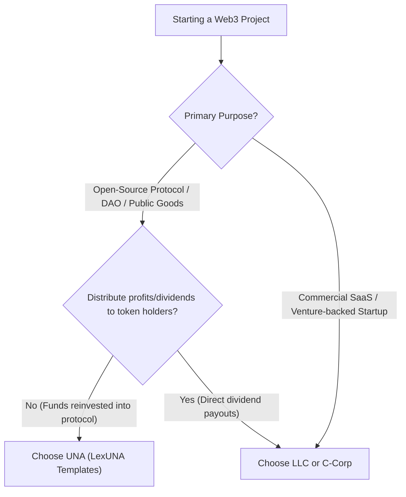

# UNA vs. LLC: Decision-Making Guide for Web3 Collectives and DAOs

When developer collectives, decentralized protocols, and open-source DAOs transition from code experiments to real-world operations, choosing the right legal wrapper is a critical architectural decision. 

Without an entity wrapper, common law jurisdictions often treat DAOs as **General Partnerships**, exposing every participant to joint and several personal liability for collective obligations.

This guide provides a side-by-side comparison between an **Unincorporated Non-Profit Association (UNA)** and a standard **Limited Liability Company (LLC)** to help your team choose the right structure.

---

## Quick Comparison Matrix

| Evaluation Dimension | Unincorporated Non-Profit Association (UNA) | Limited Liability Company (LLC) |
| :--- | :--- | :--- |
| **Formation Cost** | **$0 to minimal** (forms automatically by agreement of 2+ members; no mandatory state filing fees in most states) | **$50 – $800+** initial state filing fees + registered agent fees ($100–$300/yr) + recurring annual franchise taxes (e.g., $800/yr minimum in CA) |
| **Privacy & Anonymity** | **High**. No public registry or state certificate of formation required in most Uniform UNA Act jurisdictions. Articles remain internal agreements. | **Low to Medium**. Requires state registration, public articles of organization, designated registered agent, and FinCEN Beneficial Ownership Information (BOI) reporting. |
| **Formation Complexity** | **Low**. Requires drafting Articles of Association and member consensus/governance rules. No state approval delay. | **Medium to High**. Requires state filing paperwork, Operating Agreement, registered agent designation, and EIN registration. |
| **Liability Protection** | **Yes** (in Uniform UNA Act jurisdictions such as Wyoming, California, Texas, Delaware, Colorado). Members are shielded from entity contracts and debts. | **Yes**. Standard statutory corporate veil separating company liabilities from member assets. |
| **Primary Purpose** | **Non-profit / Public Good**. Ideal for building open-source protocols, research, grants administration, and ecosystem tooling. | **For-profit commercial enterprise**. Designed for revenue generation and shareholder dividend distributions. |
| **Profit Distribution** | **Prohibited**. Cannot distribute net dividends or capital gains to members. Surplus funds must be reinvested into the association's mission. | **Permitted**. Members can take direct capital distributions, dividend draws, and profits according to equity/membership percentage. |
| **Banking & Contracting** | Recognized as a separate legal person with capacity to enter agreements, hold assets, and open bank accounts. | Recognized corporate entity with standard access to institutional banking and vendor contracts. |
| **Ongoing Maintenance** | Minimal ongoing state reporting requirements; maintain updated member logs and meeting/on-chain governance records. | Annual reports, annual state fees, registered agent upkeep, and strict operating agreement compliance. |

---

## Understanding the "Non-Profit" Nature of a UNA

A common misconception is that "Non-Profit" means a project cannot hold funds or collect fees. 

In the legal context of a UNA:
- **Protocol Treasuries & Grants**: A UNA can receive protocol revenue, collect service fees, hold treasury funds, and disburse grant funding.
- **Contractor Payments**: A UNA can pay fair-market compensation to developers, auditors, designers, and contributors for services rendered.
- **Dividend Restriction**: A UNA **cannot** distribute dividends or passive capital returns to its members simply by virtue of holding governance tokens. All retained earnings must advance the common non-profit purpose stated in the Articles of Association.

If your collective's primary goal is building open-source infrastructure, stewarding public goods, coordinating decentralized governance, or managing a community treasury, a UNA provides legal personhood without commercial tax overhead.

Conversely, if your project intends to operate as a venture-backed startup distributing profits directly to founders and equity investors, a standard LLC or C-Corp remains the appropriate structure.

---

## Key Comparison Pillars

### 1. Cost to Form & Maintain
- **UNA**: Because a UNA is established under state adoption of the *Uniform Unincorporated Nonprofit Association Act (UUNAA)* (or common law association rules), formation occurs upon adoption of the governing agreement by two or more members. There are no state filing fees, mandatory state annual reports, or recurring franchise taxes.
- **LLC**: Forming an LLC requires paying initial state filing fees and annual franchise taxes regardless of whether the entity turns a profit. Over multiple years, maintenance fees create ongoing administrative friction for early-stage collectives.

### 2. Privacy & Member Pseudonymity
- **UNA**: Members do not need to register personal names or physical addresses on public state registries. The Articles of Association can link directly to cryptographic addresses, multisig signers, or decentralized identity handles.
- **LLC**: Most jurisdictions require listing managers, members, or organizers on public records. Recent federal regulations (such as FinCEN BOI reporting) impose strict disclosure mandates on domestic reporting companies.

### 3. Complexity & Operational Overhead
- **UNA**: Governed by internal Articles of Association and operational Bylaws. Governance can map directly to smart contract calls (e.g. Soroban or multisig resolutions) without requiring traditional board meetings or corporate resolutions.
- **LLC**: Requires formal operating agreements, member units, tax elections (pass-through vs. corporate), and formal manager appointments.

### 4. Liability Shield
- **UNA**: Under the Uniform Act (adopted in states including Wyoming, California, Colorado, Texas, and Washington, D.C.), a UNA is a separate legal person. A member or manager is not personally liable for a debt, obligation, or liability of the association merely by being a member or authorized agent.
- **LLC**: Offers statutory limited liability protection, provided the corporate veil is maintained through separate bookkeeping and avoidance of commingling personal funds.

---

## Decision Framework: Which One Should You Choose?

### Choose a UNA if:
1. You are developing open-source protocols, developer tooling, or research collectives.
2. The collective holds a treasury or receives grants to fund continued protocol development.
3. You want legal personhood to enter contracts (leases, service agreements, security audits) without personal liability.
4. Contributors value pseudonymity and want zero state incorporation fees.

### Choose an LLC if:
1. The collective's business model involves generating commercial profits to distribute directly to founders and investors.
2. You are seeking traditional equity financing (venture capital SAFEs, convertible notes).
3. The venture operates as a traditional for-profit service agency or custodial platform.

---

## Getting Started with LexUNA

To adopt a UNA structure using LexUNA:
1. Review the customizable [Articles of Association](../../templates/articles-of-association/) for your governing model.
2. Adopt the [Bylaws](../../templates/bylaws/) detailing member voting thresholds and smart contract execution mapping.
3. Archive the signed or cryptographically agreed formation documents in your repository or governance portal.

---

*Disclaimer: This guide is intended for informational and educational purposes only and does not constitute formal legal advice. Developer collectives should consult qualified legal counsel in their relevant jurisdiction.*
